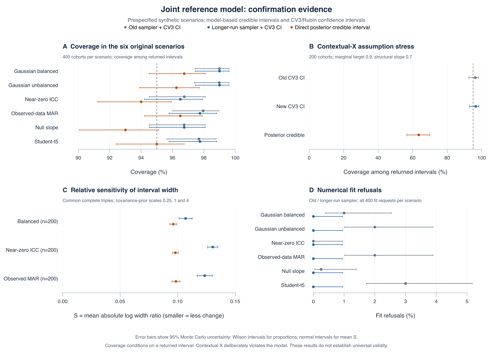
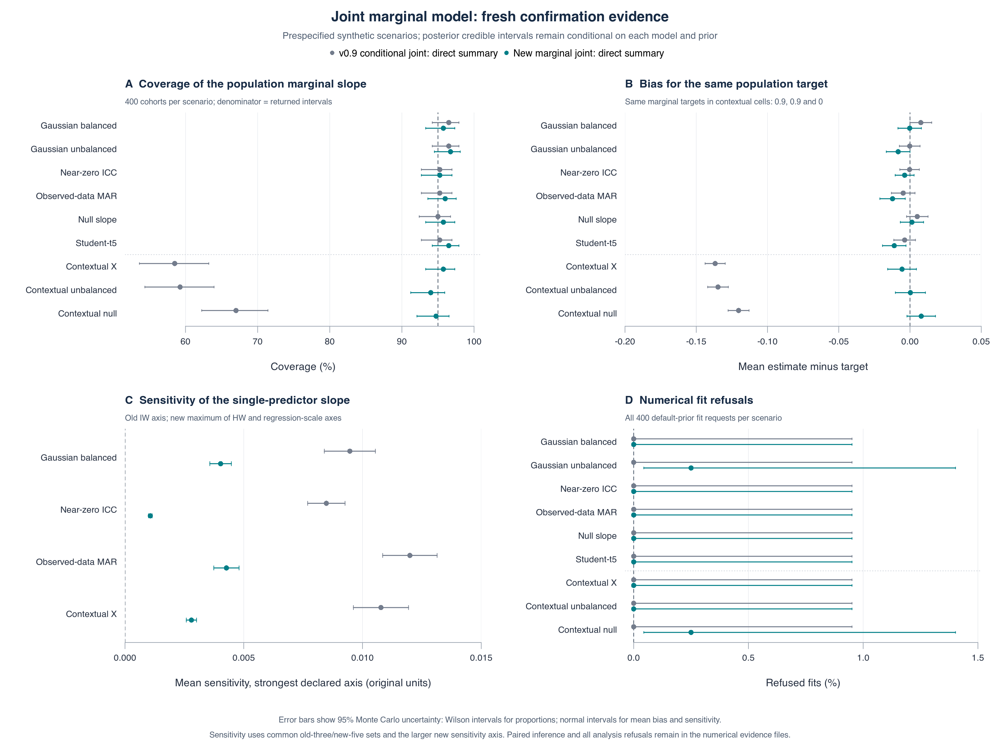

# catmech 

**An auditable R package for regression using error-prone recorded measurements and an independently checked reference subset. Version 1.0.0.**

**Contextual site effects:** the explicit `joint_marginal` model estimates measurement and predictor variation together. Use `catmech_marginal_summary()` for population marginal coefficients; see the [model and assumptions](docs/JOINT_MARGINAL_METHOD.md) and [confirmation findings](validation/JOINT_MARGINAL_SYNTHESIS.md).

**The question:** can you keep error-prone recorded values for precision without trusting them, and which method should you try first?

## How it works


Most records have a **recorded value**, which may be wrong. An **audit** checks some records against the source, so those rows also have a **checked value**. With the recommended start, catmech then works in this order:

- **Learn.** On the audited rows, fit how the checked value relates to the recorded value and the variables you list in `predictors`, which should include your analysis outcome.
- **Fill in.** Draw each unaudited row's checked value from that model, with its uncertainty, once for each of `m` completed copies. Rows with no recorded value are filled in from the other variables alone.
- **Analyze each.** Run your analysis on every completed copy.
- **Combine.** Pool the results with Rubin's rules, so the interval includes how much the copies disagree.

`catmech_reference(..., use_recorded = TRUE)` learns and fills in, and `catmech_pool_lm()` analyzes and combines. The other methods change how it learns: the default leaves the recorded value out of the model, `catmech_contamination()` models which records are wrong, and `cluster = ` adds a random intercept for each site. Linear imputation given the recorded value assumes the audit picked rows at random, or by the recorded value or other variables in the model; that checked values are exact; that rows are independent; and that the checked value follows a straight line in the recorded value, with normal scatter of constant size. The default also needs an audit that does not depend on the recorded value. Gross errors break the line ([where it fails](#which-method-to-start-with)).

A plain-language [guide](docs/learn/index.html) and an [audit simulator](docs/learn/simulator.html) walk through the same steps. Download them and open them in a browser.

## What the tests found

**The finding:** on public data with real recording differences, simple linear multiple imputation (MI) given the recorded value matched or beat `catmech_contamination()`, the recording-error model this package added. On a real audit the model often had lower point error, but its intervals failed. Start with linear MI when you need an interval.

- **Real data, 25% audits.** Linear MI had lower RMSE than the model on ClinicalTrials.gov (0.0286 against 0.0308) and less bias (+0.0001 against +0.0068). They tied on NHANES (0.0409 against 0.0408). The model's largest edge, at the 10% NHANES audit (0.0435 against 0.0490), was within Monte Carlo noise, and 14 of 200 requests returned no interval there. It could not tell which records were wrong (AUC 0.54 and 0.50).
- **What held up.** Keeping the recorded value pays. Linear MI's intervals were about half as wide as those from discarding it (0.102 against 0.205, and 0.154 against 0.297), with coverage near the all-references oracle (91.8% against 91.2%, and 93.9% against 94.9%). Against simply trusting the recorded value, a small audit often did not reduce error, and nothing tells you in advance when it will.
- **Where linear MI fails.** Under synthetic gross errors it covered 64.7%, against 94.0% for the model. It also fell to 38.0% with noisy references and 74.0% with selection on the true value. If every audited row happens to agree, it keeps the recorded values with no added uncertainty and warns you, and in that case its intervals can be badly wrong.
- **A real audit was inconclusive.** On a [health-facility recount in Rwanda](validation/REAL_AUDIT_SYNTHESIS.md), the rule fixed in advance came out inconclusive at a 25% audit. The model had lower error than linear MI on two of three slopes, but where a reported slope differed from a recount of that item its intervals covered 35% to 72%, against 90% to 97% for the recount. Linear MI's coverage held up better (79.5% at worst), and it cost accuracy where reported values were close: about 1.4 to 2.6 times the error of trusting them on the syphilis slope, on the measures used here, and more if the pool is held fixed. These are facility counts, not patient values, and gross errors remain untested on real data.
- **Clustered audits: experimental.** `catmech_reference(cluster = )` adds a random intercept for each audited site. It replaced a [first version](validation/CLUSTERED_SYNTHESIS.md) that resampled sites, in which resampling within strata understated variance. Under a [new rule fixed in advance](validation/CLUSTERED_FIX_SYNTHESIS.md) the replacement, like the first version, came out **PARTIAL**, on a Rwanda recount at a 25% audit. On six common items where linear MI fell short of a recount, it raised coverage under the variance then in use (from 79.6% to 91.0% on early antenatal visits) with lower error, though `syphilis` reached only 89.0%. On three rare items its error ran 4% to 5% higher, which failed the accuracy condition. That verdict sits within simulation noise of NO-GO. In [simulations where the audited value was a predictor](validation/VARIANCE_MI_SYNTHESIS.md), the option biased the slope, so use it only when the audited value is the outcome. In a [planned comparison with outside methods](validation/OUTSIDE_METHODS_SYNTHESIS.md), it was kept, narrowly: `mice` with the same model matched its accuracy once a default that can drop the recorded value was off, and its lead was somewhat wider intervals. A [test on another health system](validation/SECOND_SYSTEM_SYNTHESIS.md) came out mixed: errors there barely clustered, and the option added little. [Setups written by fresh agents without seeing results](validation/INDEPENDENT_SETUPS_SYNTHESIS.md) did not meet the rule either, but the best of them looks better than the option on most measures, so do not treat the option as the best available. A [planned test of separate within-cluster and between-cluster slopes](validation/WITHIN_BETWEEN_SYNTHESIS.md) was not adopted: it helped when the audited value was a predictor, and raised error on small real audits when it was the outcome. An AI assistant wrote the plans, rules, scoring and write-ups of these rounds, and no independent statistician has reviewed them.
- **Audit planning: not validated.** `catmech_audit_plan()` returned **NO-GO** under a rule fixed in advance. Its median error in predicting interval width missed the 10% limit at a 5% audit (11.3% to 16.8%). Larger targets stayed within 7.8%, but that pattern was not the test. It is a documented calculation, not a validated tool, so it is left out of the example below.

## Which method to start with

| Situation | Start with | Evidence and limit |
| --- | --- | --- |
| Most cases | `catmech_reference(..., use_recorded = TRUE)`: linear imputation given the recorded value. The package does not implement raking. In the recipes tried here, which are not its best possible use, raking tied on recording-difference datasets and had higher error on the real facility audit and in the later comparison. | Best or tied among reference-using methods on ClinicalTrials.gov and NHANES at 25% audits. On a real facility audit its average bias was near zero and its worst-case coverage the best, but it rarely had the lowest point error, and on the slopes tested first its clustered coverage, under the earlier variance, ran about 9 to 11 points below a recount's at 25%. Failed under synthetic gross errors (64.7% coverage), noisy references (38.0%) and selection on the true value (74.0%). |
| Gross, separable errors, or a fallible reference with a credible declared SD | `catmech_contamination()` | Strongest in synthetic cells with these errors (coverage 94.0% under gross errors, 91.8% with a declared reference SD), which remain untested on real data. Worse than linear MI and raking on ClinicalTrials.gov. On a real facility audit with moderate errors it often had lower point error, but its intervals were too narrow. Failed with heavy-tailed targets (87.3%) and with selection on the true value when errors were present (79.3%). |
| Target residuals doubtful and precision not critical | `catmech_reference()` (default) | Assumes least about recorded values, with intervals about twice as wide on the real data. Failed with selective references (7.3%) and noisy ones (52.7%). |
| Audit clustered by site or facility | Linear imputation with `catmech_pool_lm(cluster = )`. The other methods have not been tested with this variance. Add `catmech_reference(cluster = )` only as an experimental check. | The pooled variance is a cluster jackknife, chosen narrowly in a planned test. It repairs the analysis step only: with the audited value as the outcome, linear imputation with it still covered 81% to 86% on the worst items of a real recount at a 25% audit, against 94% to 97% for a recount. That shortfall did not appear in the same way on [another health system](validation/SECOND_SYSTEM_SYNTHESIS.md), where errors barely clustered. The imputation option came out PARTIAL in both of its planned tests, and should not be used when the audited value is a predictor. `mice` offers the same model, with a default to watch. |

"Contamination" here means recording error, not treatment spillover between trial arms.

## Try it

```r
install.packages(c("Rcpp", "RcppArmadillo", "digest", "jsonlite", "mice", "pan", "posterior", "truncnorm", "yaml"))
install.packages(".", repos = NULL, type = "source")   # from the repository directory
```

```r
library(catmech)

# Public NHANES data: self-reported and measured weight. Keep measured weight
# only on a random 25% of rows, as an audit would.
d <- read.csv("validation/real-data/nhanes-pool.csv")
d <- d[d$split == "evaluation", ]
set.seed(1)
audited <- sample(nrow(d), nrow(d) / 4)
d$audit_kg <- NA_real_
d$audit_kg[audited] <- d$reference_kg[audited]

# 1. Read what the audit shows. This fits no model.
catmech_recording_audit(d, "recorded_kg", "audit_kg", by = "sex", agreement_tol = 1)

# 2. Start with linear MI given the recorded value.
fit <- catmech_reference(
  d, "recorded_kg", "audit_kg",
  predictors = c("age", "sex", "race", "height", "sbp"),
  use_recorded = TRUE, m = 20, seed = 123
)
catmech_pool_lm(fit, sbp ~ recorded_kg + age + sex + race + height)
# recorded_kg: 0.126, 95% interval 0.097 to 0.155. With every measured weight: 0.127.
head(fit$audit)   # for each record and imputation: what was replaced, and why
```

This one audit of the whole evaluation pool is an illustration. It is not part of the frozen study.

## The evidence

[](validation/real-data-figures/real-data-evidence.pdf)

Random 25% audit, 1,000 cohorts of 600 from each evaluation pool. "Reference normal (v0.3)" discards recorded values. Select the figure for its PDF.

## Limits

- **Not clinical.** No real dataset here is a patient-level clinical source-data audit. The Rwanda audit holds facility counts, the effect-size audit comes from psychology, and on ClinicalTrials.gov both values are sponsor-entered, so the reference is not independent truth. A few public datasets say nothing about transport.
- **Synthetic simulations.** All simulation data are synthetic, and the primary cells use the error form the model assumes, which favors it.
- **No novelty or guarantee.** The methods are established, and no new statistical method is claimed. Even the oracle covered only 91.2% on ClinicalTrials.gov.
- **No outside review.** Not on CRAN, with no outside peer review or clinical validation. AI-assisted work is [disclosed](CONTRIBUTING.md).

## Read next

[Assessment](docs/ASSESSMENT.md) | [Real-audit test](validation/REAL_AUDIT_SYNTHESIS.md) | [Clustered option against outside methods](validation/OUTSIDE_METHODS_SYNTHESIS.md) | [Setups by fresh agents](validation/INDEPENDENT_SETUPS_SYNTHESIS.md) | [Separate slopes](validation/WITHIN_BETWEEN_SYNTHESIS.md) | [Another health system](validation/SECOND_SYSTEM_SYNTHESIS.md) | [Rare counts](validation/RARE_COUNTS_SYNTHESIS.md) | [Its variance](validation/VARIANCE_MI_SYNTHESIS.md) | [Its replacement test](validation/CLUSTERED_FIX_SYNTHESIS.md) | [Real-data evidence](validation/REAL_DATA_SYNTHESIS.md) | [Synthetic evidence](validation/CONTAMINATION_SYNTHESIS.md) | [Audit planner test](validation/AUDIT_PLAN_SYNTHESIS.md) | [Merged-paper go/no-go](validation/merged-audit-pilot/README.md) | [Validation record](validation/VALIDATION.md) | [Case study](docs/case-study/CASE_STUDY.md)

<!-- front-page-end: docs/case-study/fact_check.py checks every number above this line. -->

---

**Details below:** [package overview](#package-overview) | [install](#install) | [flags with no references](#flags-with-no-references-declare-a-trust-policy) | [reference subsets](#when-flags-miss-errors-use-actual-reference-information) | [recording audit and contamination model](#with-references-and-recorded-values-workflow-details) | [clustered audits](#clustered-audits-experimental) | [audit planning](#planning-an-audit-not-validated) | [categories](#use-categories-only-under-an-explicit-observation-model) | [scope and evidence](#scope-and-evidence) | [legacy API](#legacy-api) | [reproduce](#reproduce) | [license, credits and AI use](#license-credits-and-ai-use)

## Package overview

catmech provides an inspectable, auditable workflow for data with recorded measurements and reference subsets. Built on established Bayesian data augmentation, MCMC sampling, and semiparametric two-phase theory, it emphasizes explicit failure handling, prospective audit planning, and multi-endpoint regression pooling. The earlier retain/replace PMM engine remains available for **sensitivity analysis**; arbitrary retention of contaminated values caused severe bias and undercoverage in frozen validation benchmarks. See the [assessment](docs/ASSESSMENT.md), [model assumptions](docs/METHOD.md), and [validation record](validation/VALIDATION.md).

## Install

The [commands above](#try-it) install the dependencies and then the package. Run the second
command from the repository directory, or build the source archive with `R CMD build .` and
install it with `R CMD INSTALL catmech_1.0.0.tar.gz`. R 4.1 or later is required, although only R 4.6
has been tested locally. Building from source also requires a C++17 compiler and the
platform toolchain for R packages. GitHub Actions checks Linux, macOS and Windows. See the
[validation record](validation/VALIDATION.md) and [source-build guide](docs/BUILDING.md).

## Flags with no references: declare a trust policy

```r
library(catmech)

dat <- simulate_catmech_lab(n = 300, seed = 1)
# Hidden truth is for evaluation only, never an imputation predictor.
dat <- dat[setdiff(names(dat), c("lab_true", "corrupted"))]

fit <- catmech_model(
  dat, value = "lab_value",
  predictors = c("age", "sex", "inflammation", "outcome"),
  flag = "outlier_flag", category_mode = "ignore",
  m = 20, seed = 123
)

catmech_pool_lm(fit, outcome ~ lab_value + age + sex + inflammation)
head(fit$audit)
fit$model_diagnostics$summary
completed_one <- fit$completed[[1]]

# Use a new or empty directory; existing files are not overwritten.
write_catmech(fit, "output/example")
```

Including the downstream outcome in the imputation model matters. All selected
predictors must be complete. Every flagged target is replaced, including false
positive flags. Unflagged observed values are trusted and preserved exactly;
missing flags count as unflagged. This policy requires an ignorable trusted-data
selection mechanism given the predictors. It does not detect missed errors or
estimate whether any particular measurement was wrong.

## When flags miss errors: use actual reference information

Masking flagged values cannot identify errors among measurements still treated
as trusted. If an independently measured reference subset is available, use it
as the observed target and impute every unvalidated target:

```r
# A synthetic example with an audit of whole sites. In real use, reference_value contains
# actual reference measurements on selected rows, with NA elsewhere. Do not manufacture
# reference values from flags or W.
dat_with_reference <- simulate_catmech_lab(n = 600, seed = 1)
dat_with_reference$site <- rep(seq_len(30), each = 20)
audited_sites <- dat_with_reference$site %in% seq(1, 30, by = 3)
dat_with_reference$reference_value <- ifelse(audited_sites, dat_with_reference$lab_true, NA)
dat_with_reference[c("lab_true", "corrupted")] <- NULL

fit_reference <- catmech_reference(
  dat_with_reference, value = "lab_value", reference = "reference_value",
  predictors = c("age", "sex", "inflammation", "outcome"),
  method = "normal", m = 20, seed = 123
)
catmech_pool_lm(fit_reference,
  outcome ~ lab_value + age + sex + inflammation)
```

A random internal reference sample is a transparent design. Targeted verification
requires a suitable selection model and overlap; noisy references cannot be treated
as exact truth. The default omits recorded W as a predictor, sacrificing information
rather than silently retaining unvalidated values. This requires additional reference measurements. Read the
[reference method](docs/REFERENCE_METHOD.md) and
[synthetic example](inst/examples/reference.R).

For a donor-based alternative, `catmech_pmm(dat, "lab_value", predictors,
flag = "outlier_flag")` masks all flags and delegates standard type-1 PMM to `mice`.
`catmech_reference(..., method = "pmm")` restricts donors to reference rows, but
showed substantial undercoverage in the synthetic held-out study. Its pooled analysis
requires `allow_sensitivity = TRUE` and remains labeled `sensitivity_only`. `method = "pmm_abb"`
resamples donors for each imputation. That raised synthetic coverage from 86.7% to 95.9%, but it
overcovered on real data with intervals up to 51% wider than the normal method, and standard PMM did not repeat its failure
there. The reference default remains normal. Predictors must be complete. An observed category can be selected explicitly as
an ordinary factor predictor; no interval constraint is then imposed. PMM cannot
extrapolate beyond donor values and does not guarantee robustness or coverage.
The extension study compares methods given the **same predictor information**.

## With references and recorded values: workflow details

Here "contamination" means recording error, the usage in the selective-editing literature. It is
not treatment spillover between trial arms.

Read what the references show before choosing a model, then pick a method from
[the table above](#which-method-to-start-with). `catmech_recording_audit()` fits no
model. It reports disagreement rates and error sizes, tests whether rates differ across groups
such as site or flag, and compares referenced with unreferenced rows.

```r
catmech_recording_audit(dat_with_reference, "lab_value", "reference_value",
                        by = c("outlier_flag", "site"))
```

The diagnostic printout highlights the error rate and stratum heterogeneity before you fit an imputation model:

```text
-- Catmech Recording Audit --
Status:             errors_observed
Disagreements:      15 / 60 calibration rows (25.0%)
Reference subset:   60 / 600 total rows (10.0%)
Error distribution: mean = 1.9639, SD = 0.9262
Selection SMD:      -0.0246
Heterogeneity across strata:
       column levels      p_value
 outlier_flag      2 1.270818e-11
         site      3 1.000000e+00

Notes:
  * Disagreement rates differ across: outlier_flag. Consider declaring these as strata.
```

When the table points to the contamination model:

```r
fit_contamination <- catmech_contamination(
  dat_with_reference, "lab_value", "reference_value",
  predictors = c("age", "sex", "inflammation", "outcome"),
  corruption_strata = "outlier_flag", m = 20, seed = 125
)
catmech_pool_lm(fit_contamination, outcome ~ lab_value + age + sex + inflammation)
fit_contamination$contamination$corruption    # per-record posterior error probabilities
catmech_holdout_check(fit_contamination)      # scores unseen references, using no simulation truth
```

Selection into the audit may depend on recorded values, so a targeted audit is supported. Selection
on the true value beyond what the recorded value shows is not. `selection_delta` and `reference_sd`
are declared sensitivity assumptions to compare with `catmech_sensitivity()`. If the hold-out check shows
no skill against the recorded value or the stratum error rate, prefer linear MI. On ClinicalTrials.gov
and NHANES the model could not tell which records were wrong (AUC 0.54 and 0.50), so do not read its per-record
probabilities as labels on data like those. The model also assumes errors do not track the other variables. You can check
that on the audited rows, but a null is no reassurance: at a 25% audit of a [real facility recount](validation/REAL_AUDIT_SYNTHESIS.md), a clustered test
reached significance on 18% to 57% of audits where a gap existed. There the model's intervals were too narrow with or
without such tracking. See the [method](docs/CONTAMINATION_METHOD.md),
[synthetic evidence](validation/CONTAMINATION_SYNTHESIS.md), [real-data evidence](validation/REAL_DATA_SYNTHESIS.md)
and [example](inst/examples/contamination.R).

## Compare audit strategies side by side

To see how much precision is recovered and whether point estimates shift across different ways of handling un-audited records, compare all four core strategies directly on your data. By default the imputation uses every variable in the formula, outcome included, and `cluster =` gives every strategy the same cluster-robust variance:

```r
comp <- catmech_compare_strategies(
  dat_with_reference,
  value = "lab_value",
  reference = "reference_value",
  formula = outcome ~ lab_value + age + sex + inflammation
)
print(comp)

# Plot a comparative forest plot
plot(comp, term = "lab_value")

# Or fit and plot a pooled logistic or survival model directly
pooled_glm <- catmech_pool_glm(
  fit_contamination,
  formula = (outcome > 0) ~ lab_value + age + sex,
  family = binomial(),
  exponentiate = TRUE
)
plot(pooled_glm, exponentiate = TRUE)
```

### Method selection guide

```
Measurement Error Pattern
  ├── Subtle or diffuse shifts (transcription, drift)
  │     └── catmech_reference(use_recorded = TRUE)  [Recommended baseline]
  ├── Gross or separable outliers (10x decimal slips, unit errors)
  │     └── catmech_contamination()                 [Mixture error model]
  ├── Clustered multi-center data
  │     └── catmech_reference(use_recorded = TRUE) + catmech_pool_lm(cluster = "site")
  │           [catmech_reference(cluster = ) only as an experimental check,
  │            and only when the audited value is the outcome]
  └── Sensitivity check across all methods
        └── catmech_compare_strategies()            [Side-by-side comparison]
```

Whichever method you pick, when the audited value is a predictor in your analysis, put the
analysis outcome in `predictors` (for a Cox model, the event indicator and the Nelson-Aalen
cumulative hazard from `mice::nelsonaalen()`). Leaving it out biases the value's
coefficient toward zero, and the pooling functions warn when they see it.

## Clustered audits: experimental

Records from one site are not independent, so pool with a cluster-robust variance:

```r
fit_recorded <- catmech_reference(
  dat_with_reference, "lab_value", "reference_value",
  predictors = c("age", "sex", "inflammation", "outcome"),
  use_recorded = TRUE, m = 20, seed = 126
)
catmech_pool_lm(fit_recorded, outcome ~ lab_value + age + sex + inflammation, cluster = "site")
```

That applies a delete-one-cluster jackknife variance (`cv3`) to each completed dataset, then Rubin's rules with
complete-data degrees of freedom of clusters minus one. A [planned test](validation/VARIANCE_MI_SYNTHESIS.md) chose it,
narrowly, over the earlier default, which undercovered [even with every row checked](validation/VARIANCE_CHECK_RESULTS.md).
Intervals can still be too narrow with few clusters or a few influential ones, and this variance does not repair a shortfall in the imputation itself: linear imputation still undercovered on real items with it. A coefficient that a single cluster determines, such as a site type found at one site, draws a warning, because its interval can be far too narrow. Use `cluster_variance = "cr1s"` to reproduce
earlier results.

If the audited value is the analysis outcome, you can also add a random intercept for the cluster to the imputation
model by passing `cluster` to the fit. `catmech_pool_lm()` then uses that column by default:

```r
fit_clustered <- catmech_reference(
  dat_with_reference, "lab_value", "reference_value",
  predictors = c("age", "sex", "inflammation"),
  use_recorded = TRUE, cluster = "site", m = 20, seed = 126
)
catmech_pool_lm(fit_clustered, lab_value ~ age + sex + inflammation)
```

**Do not use the default moment model when the audited value is an analysis predictor.** In simulations, it biased that slope toward
zero, and `catmech_pool_lm()` warns about this use. The joint option has not been validated for that role and also warns.
The moment option's [planned test](validation/CLUSTERED_FIX_SYNTHESIS.md),
with the audited value as the outcome, came out PARTIAL: it helped where the first example's imputation fell short of a
recount and cost some accuracy on rare items. It replaced an [earlier version](validation/CLUSTERED_SYNTHESIS.md) that
resampled audited clusters. If the audit is stratified, put the strata in `predictors`; `cluster_strata` no longer exists. With one audited cluster per stratum, nothing can estimate between-cluster variance, so the fit is refused.
It assumes one normal intercept per cluster and uses approximate moment-based variance draws. Equal site sizes do not
make those draws exact posterior samples. The default `cluster_model = "moment"` still refuses a site requiring stochastic imputation for both recorded-present
and recorded-missing rows, because its separate fits do not share a site effect. Use the explicit joint option below for
that case. Audited rows and deterministically retained recorded values do not trigger the default refusal. Treat the option as a check, not a default. Fewer than five audited clusters
are refused. Very wide intervals remain possible with few audited clusters, so read the `df` column. See the
[method](docs/REFERENCE_METHOD.md#clustered-audits-experimental).

<details>
<summary><strong>Mixed recording patterns within sites: joint cluster model (Click to expand)</strong></summary>

### Mixed recording patterns within sites

Version 0.8.0 adds `cluster_model = "joint"`. It models the checked and recorded measurements together, using one
shared pair of site effects. A site can contain rows with recorded values, rows without them, and audited rows in either
pattern. A site with neither measurement observed is predicted from the population model. Checked values stay exact,
and the raw input remains in `original`.

```r
fit_joint <- catmech_reference(
  dat_with_reference, "lab_value", "reference_value",
  predictors = c("age", "sex", "inflammation"),
  use_recorded = TRUE, cluster = "site", cluster_model = "joint",
  m = 40, seed = 127
)
fit_joint$model_diagnostics$summary
# Model-based population coefficients for the original joint-model design:
catmech_joint_summary(fit_joint)
# A separately specified completed-data regression with CV3/Rubin pooling:
catmech_pool_lm(fit_joint, lab_value ~ age + sex + inflammation)
```

This is an established bivariate Gaussian mixed model fitted through `pan`, with explicit covariance priors and
multiple-chain convergence checks. It adds assumptions about the recorded measurement distribution and missingness;
it is an opt-in model change. It does not silently retain recorded values when a small audit happens to agree.
See the [model, priors and support requirements](docs/JOINT_CLUSTER_METHOD.md) and the
[initial v0.8.0 validation](validation/JOINT_CLUSTER_SYNTHESIS.md). The historical results below concern the earlier moment model.
Neither model is a demonstrated solution to rare-count undercoverage or use of the audited value as an analysis predictor.

`catmech_joint_summary()` uses all retained posterior draws and reports equal-tailed credible intervals,
original-unit coefficients and Monte Carlo errors. Its target is the population mean under the fitted joint model,
including independence of site effects from the selected covariates. It has no formula argument and cannot
replace an arbitrary downstream analysis. The Gaussian model and covariance priors still matter.

The joint sampler now starts with 4,000 retained iterations per chain and extends to 32,000 if needed,
with unchanged R-hat and ESS thresholds. Faster trace calculations make the longer runs practical.

The initial **v0.8.0** study used 200 cohorts per scenario and 40 completions, analyzed with CV3/Rubin pooling.
It found small slope bias, often conservative intervals, material covariance-prior sensitivity and some convergence
refusals at the earlier 8,000-iteration limit. Those results describe the earlier sampler profile and pooled analysis.
The fresh [v0.9.0 comparison](validation/JOINT_CALIBRATION_SYNTHESIS.md), under a
[plan fixed before execution](validation/JOINT_CALIBRATION_PLAN.md), used 2,600 cohorts and passed its three separate
screens. In the four primary Gaussian scenarios, direct-interval coverage was 93.0%–96.75%; average absolute
distance from 95% fell from 3.17 percentage points with the old CV3 analysis to 1.63 points. Across the six original
scenarios, the new sampler returned all 2,400 fits, versus 33 refusals in 2,400 under the old profile, without weaker
diagnostic thresholds. The contextual and alternative-prior fits also returned: 3,800 candidate fits in total.

Across 600 matched prior triples, relative interval-width sensitivity was 18.9% lower than CV3 on the same posterior
fits, using the prespecified absolute log-width statistic. The covariance priors are unchanged, and coefficient
estimates were not uniformly less sensitive. This is an improvement in the reported interval summaries, not evidence
that the fitted posterior is prior-insensitive.

The null-slope coverage of 93.0% remains a caution. When a covariate shared an unmodeled site cause with the target,
direct coverage fell to 63.5%, with substantial bias; candidate CV3 covered 96.5% in that particular stress case.
Use the direct summary for its declared model-based target, not as a general robust marginal-effect analysis.
See the [full results and Monte Carlo uncertainty](validation/JOINT_CALIBRATION_SYNTHESIS.md).

[](validation/joint-calibration-figures/joint-calibration-evidence.pdf)

</details>

<details>
<summary><strong>Marginal coefficients with contextual site effects (Click to expand)</strong></summary>

### Marginal coefficients with contextual site effects

Version 0.10.1 allows one further doubling to 64,000 retained iterations per
chain when the marginal sampler fails its checks at 32,000. Every diagnostic
monitor and cutoff remains in force; successful earlier attempts stop as before.
The original v0.10.0 confirmation below is preserved, with the
[numerical replay reported separately](validation/MARGINAL_EXTENSION_SYNTHESIS.md).
The complete dependent replay returned all 12,000 MCMC fits and all 27,600
analysis intervals. Both formerly failing cases pass at 64k; all four screens
now pass. All 27,596 previously successful analyses are unchanged. This repeats
the existing cohorts and is not an independent scientific confirmation.

The explicit `cluster_model = "joint_marginal"` models the checked value, recorded
value and complete continuous predictors as a joint Gaussian vector with correlated
site effects. It estimates the population regression of the checked value on the
predictors from the total site-plus-row covariance. This includes uncertainty in
the predictor distribution and preserves the distinction between a marginal slope
and a within-site slope.

```r
fit_marginal <- catmech_reference(
  dat_with_reference, "lab_value", "reference_value",
  predictors = c("age", "inflammation"),
  use_recorded = TRUE, cluster = "site", cluster_model = "joint_marginal",
  m = 40, seed = 127
)
catmech_marginal_summary(fit_marginal)
```

Predictor and conditional-measurement covariance blocks use hierarchical half-t
priors, with a separate proper prior for the regression matrices. The sampler includes
an exact scale move to improve mixing near zero site variance while preserving the
posterior. The existing conditional `joint` engine and its summary retain their
interpretations. The new engine requires continuous Gaussian predictor associations,
noninformative site sizes, exact references and ignorable observation patterns.
Categorical, incomplete, site-constant or aliased predictors are unsupported.
See the [method](docs/JOINT_MARGINAL_METHOD.md),
[runnable example](inst/examples/joint-marginal.R) and
[prospective validation plan](validation/JOINT_MARGINAL_PLAN.md).

In the v0.10.0 **3,600-cohort confirmation**, the three contextual scenarios had
**94.00%–95.75%** coverage among returned intervals, versus **58.50%–67.00%** for
the conditional model's direct summary of the same population slope. Mean
absolute contextual slope bias fell from **0.1306 to 0.0046**. Contextual and
ordinary Gaussian calibration both passed their separate prespecified screens.
Intervals in the four ordinary calibration cells were **12.2%–16.3% wider**; the new method did not establish
superior ordinary-case calibration.

Across **800** complete paired prior comparisons, measured slope sensitivity
was **70.1% lower**, using the larger of the new model's covariance-scale and
regression-scale responses. This is a comparison over declared prior ranges for
one continuous-predictor slope. The remaining shifts are close to finite-chain
Monte Carlo errors, so it is not evidence of prior independence.

**The v0.10.0 availability screen failed:** **2 of 3,600** default-prior candidate fits
refused to return, versus none for the conditional model. Both missed the
unchanged effective-sample-size cutoff at the maximum run length. Every cell
still returned at least **99%** of fits and intervals, but that does not satisfy
the separate requirement of no observed increase in refusals. The option remains
experimental; these results do not validate arbitrary contextual relationships,
multiple-predictor coverage, rare counts or use of the repaired measurement as
an analysis predictor. See [all results, uncertainty and failed screens](validation/JOINT_MARGINAL_SYNTHESIS.md).

[](validation/joint-marginal-figures/joint-marginal-evidence.pdf)

</details>

<details>
<summary><strong>Earlier moment-model evidence and validation history (Click to expand)</strong></summary>

### Earlier moment-model evidence

The earlier moment model's random-intercept regression is available elsewhere. In a [planned comparison](validation/OUTSIDE_METHODS_SYNTHESIS.md), `mice` with `2l.lmer` under
its defaults did much worse, because by default it drops a predictor correlated at 0.99 or more with the imputed variable,
which can remove the recorded value when records are good. Check `loggedEvents` if you use `mice` for audited values. With
that check off, in a rerun made after seeing the results, it matched the option's accuracy on the same cohorts, with slightly
narrower intervals and slightly lower coverage on the real items. Turning it off takes a small wrapper, because `eps = 0` is
passed on to `lmer`, which rejects it; see [the rerun's runner](tools/outside-methods-sensitivity.R). Raking and a difference
estimator had higher error on these small audits. At a 25% audit, the recorded value alone had lower error than every
audit-based method on 6 of 11 real items (five clearly, one tied), and far higher error on others, so a small audit does not
always improve a good record, and nothing here tells you in advance which case you have.

[Comparator setups written by fresh AI agents](validation/INDEPENDENT_SETUPS_SYNTHESIS.md), who saw no results, are in `tools/independent-setups/`.
None met the rule, so the option stays, but `ind_mice`, with separate within-cluster and between-cluster slopes, reached 92% on
all 11 real items at a 25% audit against the option's nine, at about the same accuracy, and largely removed the bias when the
audited value was a predictor. It missed the rule by covering above 98% on two items. These are unreviewed research code and not package features.

Those separate slopes alone did not reproduce that result. In a [later planned test](validation/WITHIN_BETWEEN_SYNTHESIS.md), adding cluster means to the option
improved coverage when the audited value was a predictor, but had 1.258 times the option's error on real items at a 25% audit,
and it was not adopted. Linear MI had lower bias than it on simulated predictor cells, and the option is unchanged.

In the [count-data experiment](validation/RARE_COUNTS_SYNTHESIS.md), coverage fell with more variable, skewed cluster frailty at both
tested count levels. The original rule returned **HEAVY TAILS**, but the generator changes variance, skewness and dependence
together; it does not isolate tail shape or rule out problems from rarity in other settings. No candidate fix or warning met
its rule. Missing an influential cluster is one possible explanation for failures, rather than a mechanism established by that
experiment. Results can also turn on one or two clusters: on [another health system](validation/SECOND_SYSTEM_SYNTHESIS.md), one district
of four clinics reversed the sign of a slope.

</details>

## Planning an audit: not validated

`catmech_audit_plan()` estimates from a random pilot how much narrower one coefficient's interval would be at each
audit fraction, keeping or discarding the recorded value, and how many records reach a chosen width. It applies classical
two-phase theory, so this is not a new result. Its prospective test on two public datasets returned **NO-GO** under a rule
fixed in advance, and it should not be described as validated. Small pilots estimated its key quantity `k` poorly, and the
interval for `k` undercovered. By formula, using each whole pool's `k`, keeping the recorded value cuts the audit needed to come within 25%
of the full-audit width from about 380 of 600 records to about 40 to 70 on these data. Read the
[planning guide](docs/AUDIT_PLANNING.md), the [test results](validation/AUDIT_PLAN_SYNTHESIS.md) and the
[example](inst/examples/audit-plan.R) before using it.

## Use categories only under an explicit observation model

```r
labels <- c("Low", "Medium", "High")

# Example sensitivity assumption, not an estimated or clinically validated matrix.
H <- matrix(.05, 3, 3, dimnames = list(labels, labels))
diag(H) <- .90                  # Rows: true category. Columns: observed category.

noisy <- catmech_model(
  dat, "lab_value", c("age", "sex", "inflammation", "outcome"),
  flag = "outlier_flag", category = "lab_category",
  thresholds = c(-Inf, 5.5, 7, Inf), levels = labels,
  category_mode = "noisy", confusion = H, m = 20, seed = 124
)

catmech_sensitivity(
  list(ignore = fit, noisy_assumption = noisy),
  outcome ~ lab_value + age + sex + inflammation,
  term = "lab_value", expected_scenarios = c("ignore", "noisy_assumption")
)
```

`category_mode = "exact"` uses exact bins and rejects contradictions with trusted
numeric values. Noisy categories use the supplied likelihood instead of forcing
values into potentially incorrect bins. Category labels stay unchanged. The matrix
is fixed: uncertainty in its entries is not propagated. A category derived from
the same corrupted measurement is not independent corroboration.

Category models use four Gibbs chains by default. Failed R-hat or effective-sample
size checks raise a `catmech_convergence_error` retaining diagnostic traces. The
[complete example](inst/examples/model.R) shows how to preserve failed scenarios
in the sensitivity report. Its envelope is descriptive, not a confidence interval
with a new coverage guarantee.

## Scope and evidence

- One continuous target, complete selected predictors, independent records (apart
  from the experimental `cluster` option) and a linear, homoskedastic Gaussian
  conditional model.
- Informative categories cover the real line, with right-closed intervals.
  Clinical boundary and rounding conventions must be reconciled first.
- Bayesian parameter uncertainty, posterior predictive completion, per-cell audit
  records, assumption/data hashes, and an externally generated `mids` adapter.
  Do not continue the adapter with `mice.mids()`.
- A prespecified held-out study compares the new workflow with ordinary trusted
  normal MI, trusted PMM, naive and oracle analyses, and the legacy method. It
  reports bias, coverage, MCSE, failures, and deliberate wrong-model stresses.
- Version 0.4 adds a synthetic study with linear MI and generalized raking as strong
  comparators, and a [real-data audit](validation/REAL_DATA_SYNTHESIS.md) on ClinicalTrials.gov and
  NHANES with real recording differences. Neither dataset is a clinical source-data audit.
- Version 0.4.1 adds the [audit planner test](validation/AUDIT_PLAN_SYNTHESIS.md), which returned NO-GO, and
  changes no existing function.
- A later [test on real audit data](validation/REAL_AUDIT_SYNTHESIS.md) uses a Rwanda health-facility recount and a
  psychology effect-size audit. It changes no package code.
- Version 0.5.0 adds the `cluster` options and their [planned test](validation/CLUSTERED_SYNTHESIS.md), which came
  out PARTIAL. Calls without `cluster` are numerically unchanged.
- Version 0.6.0 replaces the resampling in `cluster` with a random intercept after a
  [second planned test](validation/CLUSTERED_FIX_SYNTHESIS.md), which also came out PARTIAL, and removes `cluster_strata`.
  Calls without `cluster` are numerically unchanged.
- Version 0.7.0 changes the default variance in `catmech_pool_lm(cluster = )` to a delete-one-cluster jackknife after a
  [third planned test](validation/VARIANCE_MI_SYNTHESIS.md), and adds a warning. Calls without `cluster` are numerically unchanged.
- A later [comparison with outside methods](validation/OUTSIDE_METHODS_SYNTHESIS.md) kept the `cluster` option under a rule
  that could have retired it. It changes no package code.
- Version 0.7.1 adds warnings and refusals found in an [overall check](validation/OVERALL_QC.md). Numbers from earlier
  studies are unchanged.
- Later planned tests on [another health system](validation/SECOND_SYSTEM_SYNTHESIS.md), of [rare counts](validation/RARE_COUNTS_SYNTHESIS.md) and of
  [independently written setups](validation/INDEPENDENT_SETUPS_SYNTHESIS.md) change no package code, nor does a [test of separate slopes](validation/WITHIN_BETWEEN_SYNTHESIS.md).

The [v0.2 coverage protocol](validation/COVERAGE_PLAN.md) transfers useful controls from
the author's carryover, False Floor, calibration and assumption-audit research.
Independent numerical oracles check the category sampler and the reference
model's joint predictive distribution, including shared parameter uncertainty. Clinical-format
synthetic fixtures include missed flags, site shifts and rounded records.
[Transfer details](docs/RESEARCH_TRANSFER_PLAN.md) state what does and does not
carry over. The [extension study](validation/EXTENSION_SYNTHESIS.md)
reports matched-information PMM comparisons, the value of actual reference
measurements, and failures under selective or inaccurate references. These are simulation studies, not clinical validation or a general
coverage theorem. Nonlinearity, missed contamination, informative selection,
incompatible analysis models and dependent records remain limitations.

<details>
<summary><strong>Legacy API: v0.1 PMM sensitivity semantics (Click to expand)</strong></summary>

## Legacy API

`catmech_spec()` and `catmech_impute()` retain the v0.1 PMM sensitivity semantics.
Their `corruption_probability` is an imposed replacement probability, not a
posterior corruption estimate. `catmech_pool_lm()` refuses this engine unless
`allow_sensitivity = TRUE`; that override labels the result as sensitivity-only.
See the [legacy method](docs/LEGACY_METHOD.md), [example](inst/examples/lab.R),
and [historical benchmark](validation/benchmark/RESULTS.md). Existing specifications
are not silently converted to the new model.

</details>

## Reproduce

```sh
Rscript -e 'install.packages(c("testthat", "pkgload", "roxygen2"))'
Rscript -e 'testthat::test_local()'
R CMD build .
R CMD check --no-manual catmech_1.0.0.tar.gz
Rscript tools/check-v072-unchanged.R validation/my-v072-comparison.txt
Rscript validation/run-joint-marginal.R confirmation validation/my-joint-marginal
python3 -I tools/verify-joint-marginal.py validation/my-joint-marginal --tamper-tests
# Reproduce the previous direct-interval comparison from its frozen sources:
Rscript validation/v0.9.0-source/validation/run-joint-calibration.R confirmation validation/my-joint-calibration
python3 -I tools/verify-joint-calibration.py validation/my-joint-calibration --tamper-tests
# Reproduce the historical joint-model study from its frozen sources:
Rscript validation/v0.8.0-source/validation/run-joint-cluster.R heldout validation/my-joint-cluster
python3 -I tools/verify-joint-cluster.py validation/my-joint-cluster
Rscript tools/check-model-oracle.R validation/my-model-oracle
Rscript tools/coverage-benchmark.R confirmatory validation/my-heldout
Rscript tools/coverage-benchmark.R clinical validation/my-clinical
Rscript tools/check-reference-oracle.R validation/my-reference-oracle
Rscript tools/check-pooling-guards.R validation/my-pooling-guards
Rscript tools/extension-benchmark.R distribution validation/my-distribution
Rscript tools/extension-benchmark.R reference validation/my-reference-study
Rscript tools/extension-benchmark.R stress validation/my-reference-stress
Rscript tools/extension-benchmark.R controls validation/my-reference-controls
Rscript tools/check-contamination-oracle.R validation/my-contamination-oracle
Rscript tools/contamination-benchmark.R study validation/my-contamination-study
python3 -I tools/real-data-fetch.py my-raw-directory validation/my-real-data
Rscript tools/real-data-prepare.R my-raw-directory validation/my-real-data
Rscript tools/real-data-benchmark.R study validation/my-real-data-study
Rscript tools/merged-audit-pilot.R study validation/merged-audit-pilot/my-study 400
Rscript tools/audit-plan-benchmark.R study validation/my-audit-plan-study
Rscript tools/clustered-benchmark.R study validation/my-clustered-study
python3 -I tools/clustered-score.py my-clustered-decisions.txt validation/my-clustered-study
Rscript tools/clustered-review-checks.R validation/my-clustered-review
python3 -I tools/clustered-posthoc.py
Rscript tools/clustered-fix-benchmark.R study validation/my-clustered-fix-study
python3 -I tools/clustered-fix-score.py my-clustered-fix-decisions.txt validation/my-clustered-fix-study
python3 -I tools/clustered-fix-posthoc.py
Rscript tools/clustered-fix-replay.R validation/my-clustered-fix-replay
Rscript tools/oracle-variance-check.R validation/my-variance-check
python3 -I tools/oracle-variance-score.py my-variance-decisions.txt validation/my-variance-check
Rscript tools/check-cluster-algebra.R my-cluster-algebra-check.txt
Rscript tools/variance-mi-benchmark.R study validation/my-variance-mi-study
python3 -I tools/variance-mi-score.py my-variance-mi-decisions.txt validation/my-variance-mi-study
python3 -I tools/variance-mi-posthoc.py
Rscript tools/variance-mi-replay.R validation/my-variance-mi-replay
Rscript tools/outside-methods-benchmark.R study validation/my-outside-methods-study
python3 -I tools/outside-methods-score.py validation/my-outside-methods-study my-outside-methods-decisions.txt
Rscript tools/outside-methods-sensitivity.R validation/my-outside-methods-sensitivity
python3 -I tools/outside-methods-sensitivity-score.py
python3 -I tools/outside-methods-posthoc.py
Rscript tools/outside-methods-twophase-check.R my-twophase-check.txt
Rscript tools/second-system-benchmark.R study validation/my-second-system-study
python3 -I tools/second-system-score.py validation/my-second-system-study my-second-system-decisions.txt
Rscript tools/second-system-posthoc.R
Rscript tools/rare-counts-benchmark.R study validation/my-rare-counts-study
python3 -I tools/rare-counts-score.py validation/my-rare-counts-study my-rare-counts-decisions.txt
Rscript tools/independent-setups-benchmark.R study validation/my-independent-setups-study
python3 -I tools/independent-setups-score.py validation/my-independent-setups-study my-independent-setups-decisions.txt
python3 -I tools/independent-setups-posthoc.py
Rscript tools/within-between-benchmark.R study validation/my-within-between-study
python3 -I tools/within-between-score.py validation/my-within-between-study my-within-between-decisions.txt
python3 -I tools/within-between-posthoc.py validation/my-within-between-study my-within-between-posthoc.txt
python3 -I tools/within-between-shared-cells.py validation/my-within-between-study my-within-between-shared-cells.txt
python3 tools/verify-artifacts.py
```

Use new output directories. The `outside-methods` and `independent-setups` runners also need `survey`, `lme4` and `pan`, `tools/second-system-prepare.R` needs `readxl`, and `tools/check-cluster-algebra.R` needs `lme4` and `mitools`. [Validation](validation/VALIDATION.md) lists further commands, including the real-audit study. `tools/clustered-benchmark.R`, `tools/clustered-review-checks.R` and
`tools/clustered-fix-benchmark.R` ran on the resampling that version 0.6.0 replaced, so run those three from commit
`8c81044`. `tools/clustered-fix-replay.R` needs the variance that was the default through 0.6.0, so run it from `8982952`. Archived v0.1 to v0.5.0 sources retain the historical
benchmark inputs; their hashes are checked against those frozen versions. A fresh
ClinicalTrials.gov download will differ from the dated pool because the registry changes.
The v0.3.1 guards reject unsupported analyses and gate experimental reference-PMM
pooling; successful scalar estimates and intervals are unchanged. See
[validation](validation/VALIDATION.md) for evidence, environment and remaining gaps.

## License, credits and AI use

MIT license for this repository's code and documents. Dependencies and data retain their own licenses. Built on [mice](https://doi.org/10.18637/jss.v045.i03),
[pan](https://cran.r-project.org/package=pan) for the joint clustered model,
[data augmentation](https://doi.org/10.1080/01621459.1987.10478458), interval imputation
such as [hmi](https://doi.org/10.18637/jss.v095.i09), and
[multiple overimputation](https://doi.org/10.1177/0049124115585360).
AI-assisted work is disclosed in [CONTRIBUTING.md](CONTRIBUTING.md).
[GitHub notes](docs/GITHUB.md) record the repository's history and metadata.

Real-audit data come from [Nshimyiryo et al. (2020)](https://doi.org/10.1371/journal.pone.0235823),
*PLOS ONE*, under CC BY, and [Maassen et al. (2020)](https://doi.org/10.1371/journal.pone.0233107),
*PLOS ONE*, with data on [OSF](https://osf.io/7nsmd/) under CC0. See
[the data note](validation/real-audit/README.md) for what was copied and changed. Real-data pools come from
NHANES (National Center for Health Statistics) and ClinicalTrials.gov (U.S. National Library of Medicine); see
[their note](validation/real-data/README.md) for sources, changes and terms of use.
