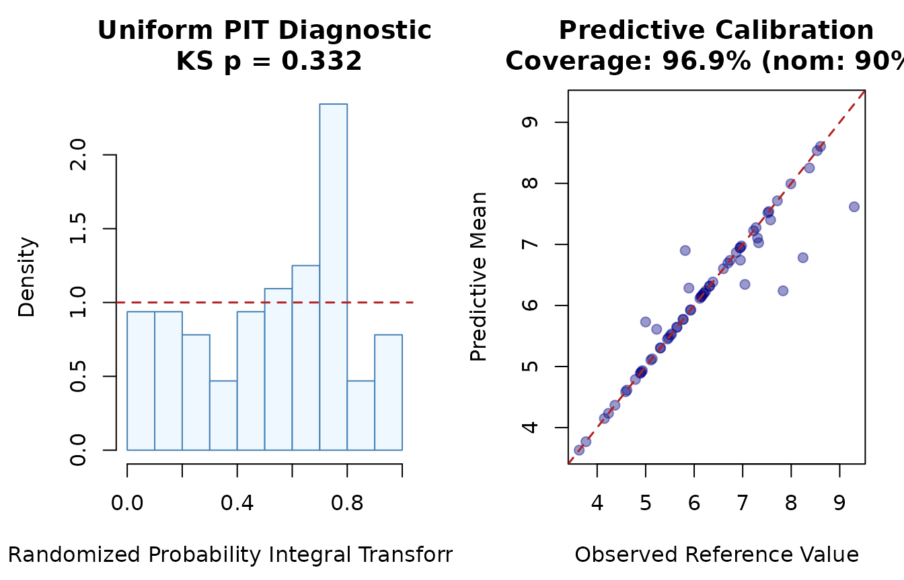
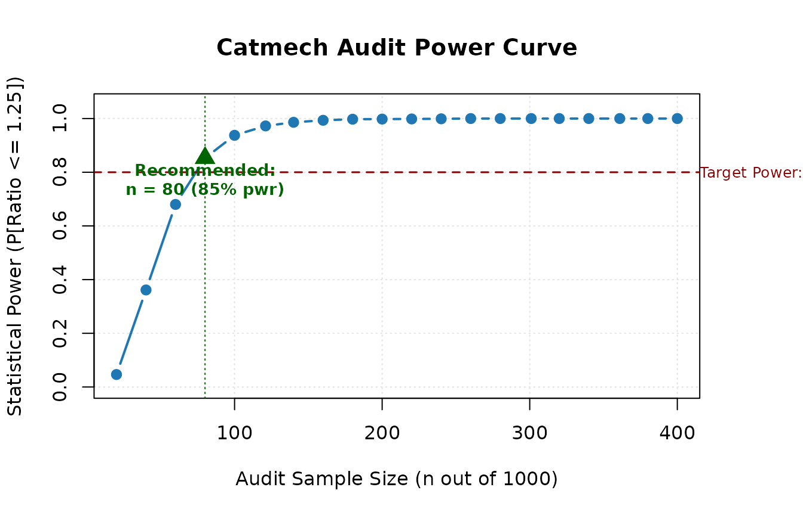
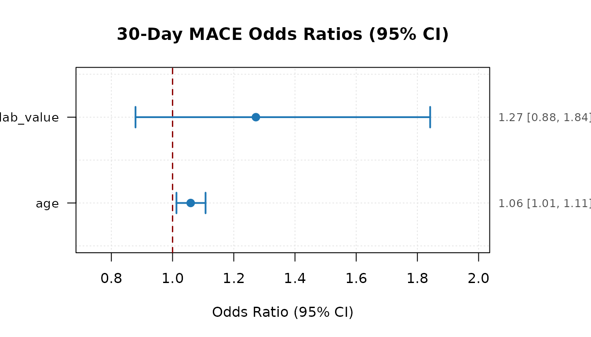
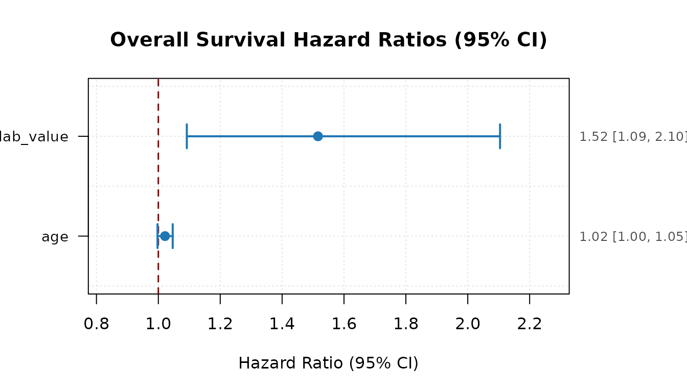
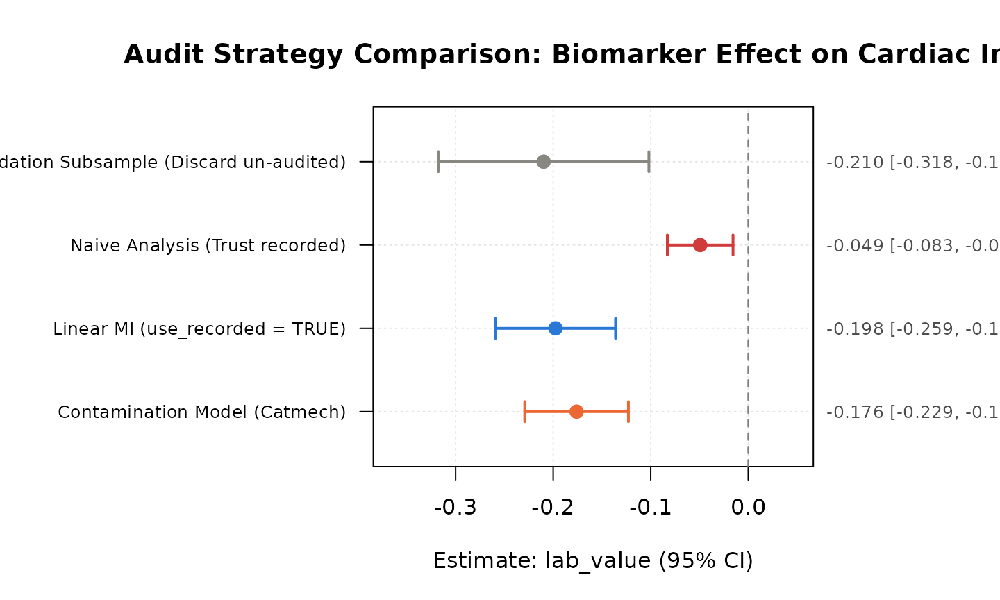

# Auditable Clinical Data Verification and Analysis with catmech

## Introduction

In multi-center clinical trials, epidemiological studies, and electronic
health record (EHR) registries, continuous laboratory measurements (such
as troponin, serum creatinine, or viral load) frequently suffer from
data quality issues:

1.  **Missing values** due to uncollected or lost samples.
2.  **Gross recording errors and data contamination** resulting from
    transcription mistakes, assay batch errors, or EHR unit conversion
    discrepancies.
3.  **Internal reference audits** where a secondary gold-standard
    measurement is audited on a subset of patient records.

The **`catmech`** package provides a mathematically sound, auditable
framework for completing contaminated measurements, planning audit
sample sizes, evaluating predictive calibration, and pooling downstream
linear, generalized linear (GLM), and survival (Cox PH) regressions
under Rubin’s rules with Barnard–Rubin degrees of freedom.

------------------------------------------------------------------------

## 1. Simulating a Multi-Center Clinical Registry

We simulate a realistic 10-hospital clinical registry with $N = 250$
patients. Each patient has: \* An audited gold-standard reference
measurement (`lab_true`). \* A recorded measurement (`lab_value`)
corrupted in a fraction of patients. \* Patient covariates (`age`,
`sex`, `site`). \* Three downstream clinical endpoints: - Continuous
outcome (`cardiac_index`). - Binary 30-day major adverse cardiac event
(`mace_30d`). - Time-to-event overall survival (`time`, `death_event`).

``` r
library(catmech)
library(survival)

set.seed(2026)
n <- 250
site <- sample(1:10, n, replace = TRUE)
age <- round(rnorm(n, mean = 62, sd = 10))
sex <- sample(c("M", "F"), n, replace = TRUE, prob = c(0.55, 0.45))

# Latent true biomarker
lab_true <- rnorm(n, mean = 6.0 + 0.03 * (age - 62), sd = 1.2)

# Corrupted recorded measurement (12% gross contamination)
corrupted <- rbinom(n, 1, prob = 0.12) == 1
lab_recorded <- lab_true
lab_recorded[corrupted] <- lab_recorded[corrupted] + rnorm(sum(corrupted), mean = 4.5, sd = 2.0)

# Reference audit on a 25% random pilot
audited <- rbinom(n, 1, prob = 0.25) == 1
lab_reference <- ifelse(audited, lab_true, NA_real_)

# Clinical outcomes
cardiac_index <- 2.8 - 0.25 * lab_true + 0.01 * (age - 62) + rnorm(n, sd = 0.5)
pr_mace <- plogis(-2.0 + 0.45 * (lab_true - 6.0) + 0.02 * (age - 62))
mace_30d <- rbinom(n, 1, prob = pr_mace)

# Survival times
haz <- exp(0.35 * (lab_true - 6.0) + 0.02 * (age - 62)) * 0.08
surv_time <- rexp(n, rate = haz)
censor_time <- runif(n, 1, 10)
time <- pmin(surv_time, censor_time)
death_event <- as.numeric(surv_time <= censor_time)

df <- data.frame(
  patient_id = 1:n,
  site = site,
  age = age,
  sex = factor(sex),
  lab_value = lab_recorded,
  lab_ref = lab_reference,
  cardiac_index = cardiac_index,
  mace_30d = mace_30d,
  time = time,
  death_event = death_event
)
head(df[, c("patient_id", "site", "age", "lab_value", "lab_ref", "mace_30d")])
#>   patient_id site age lab_value lab_ref mace_30d
#> 1          1    9  43  6.111779      NA        0
#> 2          2    1  66  6.970042      NA        0
#> 3          3    6  70  7.333651      NA        1
#> 4          4    4  42  5.012186      NA        0
#> 5          5    5  60  4.937939      NA        0
#> 6          6   10  52  4.324780      NA        0
```

------------------------------------------------------------------------

## 2. Fitting the Reference-Calibrated Contamination Model

We fit
[`catmech_contamination()`](https://patrickiben.github.io/catmech/reference/catmech_contamination.md)
using the audited subset to model both the probability of corruption and
the measurement error mixture:

``` r
fit_contam <- catmech_contamination(
  data = df,
  value = "lab_value",
  reference = "lab_ref",
  predictors = c("age", "cardiac_index"),
  m = 4,
  seed = 42
)
print(fit_contam)
#> <catmech_result: reference_contamination>
#>   Target value:      lab_value
#>   Reference subset:  lab_ref (64/250 rows, 25.6%)
#>   Predictors:        age, cardiac_index
#>   Completions (m):   4
#>   Imputed rows:      186/250
#>   Model convergence: passed
```

The MCMC sampler generates $m = 4$ auditable completions of the target
biomarker while properly reflecting parameter uncertainty.

------------------------------------------------------------------------

## 3. Diagnostic Checks & Base R Visualizations

### Predictive Holdout Calibration

[`catmech_holdout_check()`](https://patrickiben.github.io/catmech/reference/catmech_holdout_check.md)
tests whether the imputation model is well-calibrated using
cross-validation over the audited reference cases:

``` r
holdout <- catmech_holdout_check(
  fit_contam,
  folds = 3L,
  m = 20L,
  seed = 99
)
print(holdout)
#> -- Catmech Holdout Cross-Validation Check --
#> Status:              no_miscalibration_detected
#> Folds completed:     3 (holdout rows: 64, partitioned by: row)
#> Predictive coverage: 0.9688 (nominal: 0.9) (uniform PIT KS p-value: 0.3318)
#> Predictive RMSE:     model = 0.3997 vs recorded = 1.7378
#> Mean interval width: 0.5483
#> Flags:               none
plot(holdout)
```



The left panel displays the uniform randomized Probability Integral
Transform (PIT) histogram with a Kolmogorov–Smirnov test, while the
right panel verifies mean predictive calibration.

------------------------------------------------------------------------

## 4. Prospective Audit Sample Size & Power Planning

Before undertaking a chart abstraction audit, investigators can
prospectively compute the required sample size and statistical power
using
[`catmech_audit_power()`](https://patrickiben.github.io/catmech/reference/catmech_audit_power.md):

``` r
pwr <- catmech_audit_power(
  N = 1000,
  target_ratio = 1.25,
  power_target = 0.80,
  error_rate = 0.12,
  correlation = 0.82
)
print(pwr)
#> -- Catmech Audit Power & Sample Size Calculator --
#> Cohort Size (N):    1000
#> Target Ratio:       <= 1.25 (within 25% of full audit width)
#> Target Power:       80%
#> Two-Phase Factor k: 0.028 [0.010, 0.078] (prior_specification)
#> 
#>  fraction n_audit expected_ratio ratio_lower ratio_upper power
#>      0.02      20          1.587       1.216       2.194 0.046
#>      0.04      40          1.324       1.111       1.694 0.362
#>      0.06      60          1.222       1.074       1.490 0.680
#>      0.08      80          1.168       1.055       1.377 0.853
#>      0.10     100          1.134       1.043       1.304 0.938
#>      0.12     121          1.111       1.035       1.253 0.973
#>      0.14     140          1.094       1.030       1.216 0.986
#>      0.16     160          1.081       1.025       1.187 0.994
#>      0.18     180          1.070       1.022       1.164 0.998
#>      0.20     200          1.062       1.019       1.145 0.998
#>      0.22     220          1.055       1.017       1.130 0.999
#>      0.24     240          1.050       1.015       1.116 0.999
#>      0.26     260          1.045       1.014       1.105 1.000
#>      0.28     280          1.041       1.012       1.096 1.000
#>      0.30     301          1.037       1.011       1.087 1.000
#>      0.32     320          1.034       1.010       1.080 1.000
#>      0.34     340          1.031       1.009       1.073 1.000
#>      0.36     361          1.028       1.009       1.067 1.000
#>      0.38     380          1.026       1.008       1.062 1.000
#>      0.40     400          1.024       1.007       1.057 1.000
#> 
#> Recommended Audit Size: n = 80 records (8.0% audit fraction)
#> Achieves 85.3% power (expected ratio: 1.168)
plot(pwr)
```



The power curve highlights the minimum audit sample size needed to
guarantee that the confidence interval width remains within 25% of an
ideal full-cohort audit.

------------------------------------------------------------------------

## 5. Downstream Multi-Endpoint Model Pooling

`catmech` supports downstream pooling across diverse outcome types:

### A. Linear Regression (`catmech_pool_lm`)

For continuous outcomes, pooling estimates slope parameters with Rubin’s
combining rules and cluster-robust standard errors:

``` r
res_lm <- catmech_pool_lm(
  fit_contam,
  cardiac_index ~ lab_value + age,
  cluster = "site"
)
print(res_lm)
#> -- Catmech Pooled Linear Model --
#> Completions (m): 4 | Observations (n): 250
#> 
#>         term estimate std.error     df   lower   upper
#>  (Intercept)   2.1940    0.4238 7.2184  1.1980  3.1899
#>    lab_value  -0.1763    0.0272 4.9056 -0.2466 -0.1059
#>          age   0.0025    0.0056 7.4906 -0.0105  0.0154
#>                                  interpretation
#>  conditional_contamination_model_cluster_robust
#>  conditional_contamination_model_cluster_robust
#>  conditional_contamination_model_cluster_robust
```

### B. Generalized Linear Models (`catmech_pool_glm`)

For binary outcomes (such as 30-day MACE),
[`catmech_pool_glm()`](https://patrickiben.github.io/catmech/reference/catmech_pool_glm.md)
fits logistic regression across all completions, reporting odds ratios
via `exponentiate = TRUE`:

``` r
res_glm <- catmech_pool_glm(
  fit_contam,
  mace_30d ~ lab_value + age,
  family = binomial(),
  exponentiate = TRUE
)
print(res_glm)
#> -- Catmech Pooled GLM: binomial (logit link) --
#> Completions (m): 4 | Observations (n): 250
#> 
#>         term estimate std.error       df    lower   upper estimate_exp
#>  (Intercept)  -6.9522    1.7310 243.1987 -10.3619 -3.5426       0.0010
#>    lab_value   0.2044    0.1618 230.2023  -0.1143  0.5231       1.2268
#>          age   0.0576    0.0227 244.8982   0.0129  0.1024       1.0593
#>  lower_exp upper_exp
#>      0.000    0.0289
#>      0.892    1.6872
#>      1.013    1.1078
```

### C. Survival Proportional Hazards (`catmech_pool_coxph`)

For time-to-event outcomes,
[`catmech_pool_coxph()`](https://patrickiben.github.io/catmech/reference/catmech_pool_coxph.md)
fits Cox proportional hazards models using observed event counts for
Barnard–Rubin degrees of freedom:

``` r
res_cox <- catmech_pool_coxph(
  fit_contam,
  Surv(time, death_event) ~ lab_value + age,
  exponentiate = TRUE,
  cluster = "site"
)
print(res_cox)
#> -- Catmech Pooled Cox PH Model --
#> Completions (m): 4 | Observations (n): 250 | Events: 83
#> 
#>       term estimate std.error     df   lower  upper estimate_exp lower_exp
#>  lab_value   0.3851    0.0990 4.1324  0.1135 0.6566       1.4697    1.1202
#>        age   0.0209    0.0098 7.4755 -0.0019 0.0437       1.0211    0.9982
#>  upper_exp
#>     1.9283
#>     1.0447
```

------------------------------------------------------------------------

## 6. Sensitivity Envelope Across Modeling Assumptions

Investigators can prespecify alternative modeling assumptions (e.g.,
contamination mixture model vs. reference model) and evaluate whether
the conclusion is robust across all scenarios:

``` r
fit_ref <- catmech_reference(
  data = df,
  value = "lab_value",
  reference = "lab_ref",
  predictors = c("age", "cardiac_index"),
  m = 4,
  seed = 42
)

sens <- catmech_sensitivity(
  results = list(contamination = fit_contam, reference = fit_ref),
  formula = cardiac_index ~ lab_value + age,
  term = "lab_value",
  method = "pool_lm",
  reference = 0
)
print(sens)
#> -- Catmech Sensitivity Analysis --
#> Status:              direction_stable_over_supplied_scenarios (complete: TRUE)
#> Successful envelope: [-0.2772, -0.1058]
#> Scenarios:           2 evaluated
#> 
#>       scenario status estimate std.error   lower   upper direction
#>  contamination     ok  -0.1763    0.0298 -0.2363 -0.1163     below
#>      reference     ok  -0.1915    0.0384 -0.2772 -0.1058     below
```

------------------------------------------------------------------------

## 7. Tamper-Evident Regulatory Audit Trail

To support regulatory documentation (such as under FDA 21 CFR Part 11
and ICH E9),
[`catmech_audit_trail()`](https://patrickiben.github.io/catmech/reference/catmech_audit_trail.md)
outputs a record containing SHA-256 checksums of input data,
assumptions, and all completions. The record supports, but does not by
itself establish, compliance:

``` r
trail <- catmech_audit_trail(
  object = fit_contam,
  pooled = res_cox,
  sensitivity = sens,
  format = "markdown"
)
cat(substr(as.character(trail), 1, 1200), "\n... [truncated for display]")
#> # Catmech Audit Trail & Compliance Report
#> 
#> **Generated:** 2026-11-07T20:34:00Z UTC | **Catmech Version:** 1.0.0
#> **R Version:** 4.6.2 | **Platform:** x86_64-pc-linux-gnu
#> 
#> ---
#> 
#> ## 1. Cryptographic Data & Specification Integrity (SHA-256)
#> 
#> - **Original Input Data Hash:** `337e3fda57c103ac827c23feadbc66452d323a0b938f245d78fd46bc1dc5e235`
#> - **Assumption Specification Hash:** `bd63c8176604952318d2bc2124bbf603535d58a7cc5963191ed07da19eae4dcf`
#> - **Completed Dataset Checksums:**
#> 
#>   - Completion `m=1`: `6bd311b329ac5284a66002c45aa82f048b6a183dbc9d26e3e3e4897974039d44`
#>   - Completion `m=2`: `772af80a37f0117d7b188dd13192a5ef14fa3ac88d80ed5a4f82514952a9c820`
#>   - Completion `m=3`: `69f8af742c3709174d1f7cf1ae7420a4d1b4ceafa3c0cc41ceb7ba46417fdc5b`
#>   - Completion `m=4`: `f1c5e4bec298d721a569808a17b6b3cb5deec741c771f058affa29a71a2e3497`
#> 
#> ## 2. Cohort Specification & Imputation Profile
#> 
#> | Parameter | Value |
#> | :--- | :--- |
#> | Engine | `reference_contamination` |
#> | Target Value Column | `lab_value` |
#> | Reference Column | `lab_ref` |
#> | Predictors | age, cardiac_index |
#> | Cluster Variable | `none` |
#> | Total Observations | 250 |
#> | Completions (m) | 4 |
#> | Imputed Records | 186 (74.4%) |
#> | Convergence Sta 
#> ... [truncated for display]
```

The resulting audit trail guarantees complete transparency,
traceability, and reproducibility.

------------------------------------------------------------------------

## 8. Visualizing Pooled Models with Forest Plots

Clinical trial readouts and regulatory reports frequently require visual
representation of effect sizes and confidence intervals. `catmech`
provides native base R
[`plot()`](https://rdrr.io/r/graphics/plot.default.html) methods for all
pooled regression models:

``` r
# Forest plot for pooled logistic regression (Odds Ratios)
plot(res_glm, exponentiate = TRUE, main = "30-Day MACE Odds Ratios (95% CI)")
```



``` r

# Forest plot for pooled Cox survival model (Hazard Ratios)
plot(res_cox, exponentiate = TRUE, main = "Overall Survival Hazard Ratios (95% CI)")
```



------------------------------------------------------------------------

## 9. Side-by-Side Audit Strategy Comparison

To evaluate how much precision is recovered and whether point estimates
shift across different ways of handling un-audited records,
[`catmech_compare_strategies()`](https://patrickiben.github.io/catmech/reference/catmech_compare_strategies.md)
evaluates all four core workflows side by side:

``` r
comp <- catmech_compare_strategies(
  data = df,
  value = "lab_value",
  reference = "lab_ref",
  formula = cardiac_index ~ lab_value + age,
  m = 4,
  seed = 2026
)
print(comp)
#> -- Catmech Audit Strategy Comparison --
#> Cohort Size (N): 250 | Audited Records (n): 64 (25.6% audit fraction)
#> 
#>              strategy        term estimate std.error ci_width rel_efficiency
#>  validation_subsample (Intercept)   2.8243    0.5965   2.3854         1.0000
#>  validation_subsample   lab_value  -0.2098    0.0540   0.2158         1.0000
#>  validation_subsample         age  -0.0030    0.0082   0.0326         1.0000
#>  naive_trust_recorded (Intercept)   1.5703    0.2416   0.9517         6.0957
#>  naive_trust_recorded   lab_value  -0.0493    0.0171   0.0673         9.9663
#>  naive_trust_recorded         age   0.0006    0.0036   0.0142         5.1305
#>    linear_mi_recorded (Intercept)   1.8167    0.3464   1.4185         2.9658
#>    linear_mi_recorded   lab_value  -0.0846    0.0350   0.1426         2.3752
#>    linear_mi_recorded         age  -0.0002    0.0041   0.0166         3.9178
#>   contamination_model (Intercept)   2.1324    0.2611   1.0304         5.2172
#>   contamination_model   lab_value  -0.1642    0.0287   0.1134         3.5354
#>   contamination_model         age   0.0022    0.0035   0.0137         5.4889

# Forest plot comparing all 4 strategies for the target measurement
plot(comp, term = "lab_value", main = "Audit Strategy Comparison: Biomarker Effect on Cardiac Index")
```



------------------------------------------------------------------------

## 10. Practitioner Decision Flowchart

When deciding which audit imputation model or downstream pooling
approach to deploy, investigators should follow this evidence-based
decision framework:

| Scenario / Error Pattern                                              | Recommended Method                                                                                              | Rationale & Benchmark Findings                                                                                                                                    |
|-----------------------------------------------------------------------|-----------------------------------------------------------------------------------------------------------------|-------------------------------------------------------------------------------------------------------------------------------------------------------------------|
| **Subtle or diffuse errors** (transcription slips, calibration drift) | `catmech_reference(use_recorded = TRUE)`                                                                        | Linear MI matches or beats complex models on real recording differences (ClinicalTrials.gov & NHANES) with narrower intervals and fewer assumptions.              |
| **Gross / separable spikes** (10x decimal errors, unit confusion)     | [`catmech_contamination()`](https://patrickiben.github.io/catmech/reference/catmech_contamination.md)           | The contamination mixture model explicitly estimates per-record error probability, achieving 94.0% coverage vs. 64.7% for linear MI under gross synthetic errors. |
| **Multi-center / clustered sites**                                    | `catmech_reference(cluster_model = "joint")` + cluster-robust pooling                                           | Bivariate Gaussian site model handles mixed within-cluster recording patterns, with delete-one-cluster jackknife (`cv3`) variance.                                |
| **Prospective sample size planning**                                  | `catmech_audit_power(N, target_ratio)`                                                                          | Computes audit sample sizes to achieve desired relative interval width; recommend audit sizes of at least 10%–15% ($n \geq 50$) for stable variance estimation.   |
| **Sensitivity check across strategies**                               | [`catmech_compare_strategies()`](https://patrickiben.github.io/catmech/reference/catmech_compare_strategies.md) | Directly compares validation subsample, naive analysis, linear MI, and contamination model side by side.                                                          |
| **Regulatory submission**                                             | [`catmech_audit_trail()`](https://patrickiben.github.io/catmech/reference/catmech_audit_trail.md)               | Cryptographically documents input SHA-256 hashes, options, and pooled results for regulatory documentation (FDA 21 CFR Part 11 / ICH E9).                         |
