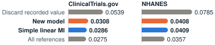

# catmech: when the favored model did not win

**A case study in testing an idea until the evidence said no.** Patrick Iben, independent biostatistician. Status on November 5, 2026: R package, version 1.0.0, with no outside users, peer review or clinical validation.

| Test | Result | What the numbers said |
|---|---|---|
| Simulations that favored the new model | Model looked strong | Uncertainty ranges 30% to 38% narrower than the old default |
| Two public datasets, recording differences | Model lost or tied | Simple method lower error on ClinicalTrials.gov, tied on NHANES at a 25% audit |
| A real facility audit, not patient values | Inconclusive | Lower error on two of three slopes, but ranges covered 35% to 72%; a recount's, 90% to 97% |
| Clustered-audit option, second version | PARTIAL | Helped on six common items; error 4% to 5% higher on three rare ones |
| Merged-paper idea, in simulation | NO-GO | Targeting by network position did not beat auditing the most suspicious records |
| Audit-size planner, on public data | NO-GO | Median error of 11.3% to 16.8% at the smallest audit, against a 10% limit |

## The problem

Records contain mistakes, and checking every record against its source is expensive, so studies often check only a sample, called an audit. The analyst then has two poor options: discard the unchecked recorded values and lose precision, or trust them and risk a distorted answer. The project asked whether a model could use recorded values without trusting them.

## What was built

catmech is an R package for multiple imputation and audits that logs replacements and refuses to run when data cannot support a request. Version 0.4 added a model estimating each record's error probability, tested against linear imputation. Version 1.0.0 adds GLM and Cox pooling, power curves, and audit trails. A plain-Python script recomputes reported summaries.

## What the evidence showed

**Simulations favored the model.** Its uncertainty ranges were 30% to 38% narrower than the old default, and it passed its coverage screen (how often the ranges contain the truth) in three of four main scenarios. Those scenarios used the kind of error the model assumes. It failed narrowly in the fourth, and clearly with extreme values in the data, audits selected on the true value, and noisy checked values that went undeclared.

**Real data did not.** On real recording differences in ClinicalTrials.gov and NHANES, the simple baseline matched or beat the model at a 25% audit. Across all nine real-data scenarios, the model was never clearly better. It also could not tell which records were wrong (AUC 0.54 and 0.50, where 0.50 is a coin flip). The useful result was plainer: keeping the recorded value nearly halved the error compared with discarding it, and the baseline got that gain with fewer assumptions.

**Two more ideas failed their tests.** A merged paper would have argued that audits in cluster trials should follow the direction in which errors spread between sites. In simulation, audits helped, but direction added nothing. An audit-size planner's median error stayed within 7.8% for larger audits but missed the 10% limit at the smallest, 30 of 600 records. The rule had no exception for that pattern, so the verdict stands.

**A clustered-audit option came out partial.** Resampling audited facilities helped where the simple method fell short, raised error elsewhere and understated variance within strata. A random-intercept replacement also came out partial, with error on rare items 4% to 5% above the simple method's.

**Keeping the recorded value nearly halved the error.** RMSE of the estimated slope at a 25% audit, 1,000 cohorts of 600. "All references" uses every checked value: a benchmark, not a usable method.

## The decision

- **Recommend the simple baseline first when an interval is needed.** It is now a package option. The new model stays for gross errors, untested on real data, where the baseline's 95% ranges covered only 64.7% in simulation, against 94.0%.
- **Do not write the merged paper** on that thesis.
- **Keep the planner as a documented calculation,** labeled not validated, **and the clustered-audit option as experimental,** for an audited outcome; `mice` fits the same model.
- **Claim no new statistical method.**

## Technical sidebar

Target: each pool's regression coefficient using every reference, in cohorts of 600 resampled from pools of 27,208 and 3,908 rows, with 1,000 cohorts at a 25% audit and m = 20. Coverage, linear MI against the contamination model: 91.8% and 91.2% on ClinicalTrials.gov, 93.9% and 94.5% on NHANES. The oracle covered 91.2% and 94.9%, so coverage was judged against it. Paired MSE difference on ClinicalTrials.gov: 1.31e-4 (MCSE 2.2e-5). Every study had a written plan before its evaluation run, and earlier looks are disclosed. The planner test was prospective for the code but not fully blind, because earlier tables from those pools had been seen.

## Limits and AI disclosure

No dataset here is a patient-level clinical source-data audit, and on ClinicalTrials.gov both values are sponsor-entered. Simulation data are synthetic. OpenAI Codex and Anthropic Claude Code were used for code, literature search, review and test construction. Claude Code also wrote most later plans and scoring and helped draft this page, with no independent review. No AI system is listed as an author, and AI review is not peer review. Patrick retains responsibility for the scientific claims, intended-use decisions and release.

Sources in `validation/`: [`REAL_DATA_SYNTHESIS.md`](../../validation/REAL_DATA_SYNTHESIS.md), [`CONTAMINATION_SYNTHESIS.md`](../../validation/CONTAMINATION_SYNTHESIS.md), [`merged-audit-pilot/README.md`](../../validation/merged-audit-pilot/README.md), [`AUDIT_PLAN_SYNTHESIS.md`](../../validation/AUDIT_PLAN_SYNTHESIS.md), [`REAL_AUDIT_SYNTHESIS.md`](../../validation/REAL_AUDIT_SYNTHESIS.md), [`OUTSIDE_METHODS_SYNTHESIS.md`](../../validation/OUTSIDE_METHODS_SYNTHESIS.md). Every number is traced in [`docs/case-study/FACT_CHECK.md`](FACT_CHECK.md).
