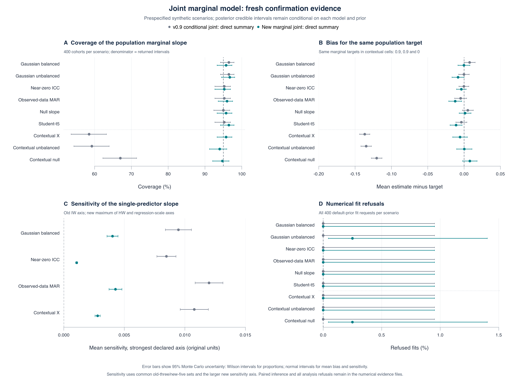

# Contextual marginal inference: confirmation and limits

The explicit `joint_marginal` option corrects the tested contextual failure of
the old direct conditional-model summary and reduces measured sensitivity of
the single-predictor slope over both declared prior axes. Fresh confirmation
passes the contextual, ordinary-calibration and slope-sensitivity screens.
**The availability nonregression screen fails:** two candidate default fits
refused at the maximum iteration budget, compared with none for the frozen
v0.9.0 procedure. This supports an experimental option with an explicit
population target and additional predictor-distribution assumptions; it does
not establish a universally better default
or eliminate convergence failures.

The [prospective plan and amendments](JOINT_MARGINAL_PLAN.md),
[first development failure](JOINT_MARGINAL_DEVELOPMENT_REVIEW.md) and
[second development decision](JOINT_MARGINAL_D2_DECISION.md) precede these
confirmation results. No confirmation cohort was retried, replaced or removed,
and no prior, interval rule or diagnostic threshold was retuned against them.

[](joint-marginal-figures/joint-marginal-evidence.pdf)

## What changed, and which target is being tested

The new model jointly models the true measurement `T`, recorded measurement
`W` and complete continuous predictors `X` using Gaussian site and row effects.
Its population marginal slope is `solve(V_XX, V_XT)`, where `V = Psi + Sigma`;
the intercept is `mu_T - beta' mu_X`. The reported mean, posterior SD and
equal-tailed 95% interval summarize this transformation of retained draws in
original units. The posterior transformation propagates uncertainty in the predictor distribution.
It is not the within-site structural slope or the realized cohort's OLS slope.
The existing `joint` model, direct conditional summary and CV3/Rubin analysis
retain their meanings and remain available.

Each covariance matrix is parameterized by predictor covariance `S`,
conditional measurement covariance `Omega` and a proper regression matrix
`B`: `Q_XX = S`, `Q_XR = S B`, `Q_RR = Omega + B' S B`, for `R = (T,W)`.
Here `B` has predictors in rows and measurement responses in columns. The
Huang--Wand priors on `S` and `Omega` have half-t2 marginal standard deviations;
`B | Omega` is matrix normal with row covariance
`regression_scale^2 I` and column covariance `Omega`. These half-t and
correlation statements concern the component blocks, not the full `Q`.
Defaults are `prior_scale = 1` and `regression_scale = 10` after fixed empirical
standardization. Proper regression priors protect the zero predictor-site-
variance boundary from the problem created by a flat regression prior.
The blocked sampler and exact log-scale Metropolis moves target this specified
posterior. [Full model, prior, derivation and restrictions](../docs/JOINT_MARGINAL_METHOD.md).

The old and new models and prior families differ together. The comparison
therefore does not isolate a causal contribution of the prior family, sampler
or predictor model. This is an implementation and finite-simulation result,
not a new-method claim.

## Fresh confirmation design and complete denominators

There are 400 cohorts in each of nine fixed cells: 3,600 cohorts, 12,000 MCMC
fit requests and 3,600 complete-truth oracle workflows. Both direct and
CV3/Rubin analyses are requested from each imputed fit, giving 27,600 analyses.
The first 200 cohorts in four fixed cells receive the extra prior fits.
All methods see the same public cohort; only the oracle and scorer see
unselected true measurements. There are 240 rows at 24 sites, exact reference
measurements on a subset, observed and missing recorded values, and six sites
excluded from audit by design. Additional sites can receive no references by
chance. Ordinary audits contain 60 rows; observed-MAR audits have expected
size 60 without forcing the realized size or support.

The first seven DGMs are exactly the previous study's code, checked on matched
seeds; contextual unbalanced and contextual null are added. Gaussian balanced,
Gaussian unbalanced, near-zero ICC, observed-data MAR and Student-t5 target
0.7; ordinary null targets zero. In contextual cells `X = a_site + z_row`,
with both variances one, and `T` contains an additional `0.4*a_site` effect.
The marginal target is consequently structural slope plus 0.2: **0.9, 0.9
and zero** for the three contextual cells, with structural slopes 0.7, 0.7
and -0.2. Both methods are scored against those same targets. Unbalanced
masking rounds to 35% missing recorded values, versus 30% in balanced cells,
so the unbalanced comparison does not isolate site-size imbalance.

All chains use the unchanged four-chain, 1,000-burn-in, 4k/8k/16k/32k retained-
iteration schedule. Every required monitor must have rank-normalized R-hat
at most 1.05 and bulk and tail ESS at least 400. Forty completed datasets are
used for CV3/Rubin; direct summaries use all retained parameter draws.

| Requests | Requested | Returned | Refused |
| --- | ---: | ---: | ---: |
| Frozen v0.9.0 MCMC fits, all prior settings | 5,200 | 5,200 | 0 |
| Candidate MCMC fits, all prior settings | 6,800 | 6,798 | 2 |
| Complete-truth oracle workflows | 3,600 | 3,600 | 0 |
| Old direct and CV3 analyses | 10,400 | 10,400 | 0 |
| Candidate direct and CV3 analyses | 13,600 | 13,596 | 4 |
| Oracle analyses | 3,600 | 3,600 | 0 |

The 3,600 default candidate fits include both refusals; all 3,200 extra
candidate prior fits return. There are no summary-only failures. Coverage
below is conditional on returned intervals unless explicitly labeled
per-request. Per-request coverage counts a refusal as no covered interval.
Point-screen thresholds do not require the entire uncertainty interval to
lie inside the screening band. With 400 cohorts, coverage near 95% has MCSE
about 1.1 percentage points; passing these finite-sample screens is not proof
of exact repeated-sampling calibration.

## Contextual correction passes for the unchanged marginal target

| Context and target | Old direct coverage | New covered / returned | New coverage (95% Wilson interval) | New bias (MCSE) |
| --- | ---: | ---: | ---: | ---: |
| Balanced, 0.9 | 58.50% | 383/400 | 95.75% (93.30–97.33) | -0.00558 (0.00514) |
| Unbalanced, 0.9 | 59.25% | 376/400 | 94.00% (91.23–95.94) | 0.00029 (0.00537) |
| Null, 0 | 67.00% | 378/399 | 94.74% (92.09–96.53) | 0.00788 (0.00510) |

Each point coverage lies within the prespecified 92.5%–97.5% band and each
absolute point bias is below 0.02. The equal-cell **coverage-per-request**
gain is 33.17 percentage points (MCSE 1.52; 95% Monte Carlo interval 30.18
to 36.16), with positive gains in every cell. New contextual-null coverage
per request is 378/400, or 94.50%, retaining its refusal in the denominator.
Equal-cell mean absolute bias falls from 0.13059 to 0.00458. Its paired
bootstrap difference is -0.12600 (95% interval -0.13012 to -0.11758).
These are improvements in both centering and interval performance against
the same population target, not a switch to an easier within-site target.

New contextual mean interval widths are 0.4254, 0.4310 and 0.4159, versus
0.3100, 0.3107 and 0.2991 for the old direct summary. The contextual benefit
therefore includes greater uncertainty, as well as lower bias. Bias estimates
remain estimates; this study does not establish exact unbiasedness.

## Ordinary calibration passes without evidence of superiority

| Cell | Old direct coverage | New covered / returned | New coverage (95% Wilson interval) | New bias (MCSE) |
| --- | ---: | ---: | ---: | ---: |
| Gaussian balanced | 96.50% | 383/400 | 95.75% (93.30–97.33) | -0.00023 (0.00419) |
| Gaussian unbalanced | 96.50% | 386/399 | 96.74% (94.51–98.09) | -0.00831 (0.00424) |
| Observed-data MAR | 95.25% | 384/400 | 96.00% (93.60–97.52) | -0.01224 (0.00454) |
| Null slope | 95.00% | 383/400 | 95.75% (93.30–97.33) | 0.00137 (0.00415) |
| Near-zero ICC stress | 95.25% | 381/400 | 95.25% (92.70–96.94) | -0.00376 (0.00337) |
| Student-t5 stress | 95.25% | 386/400 | 96.50% (94.21–97.90) | -0.01106 (0.00420) |

The first four cells define the ordinary screen; the last two remain separate
stress evidence. All four primary point coverages and biases meet the fixed
bounds. Their mean absolute coverage distance from 95% is 1.0605 percentage
points for the new procedure and 0.8125 for the old. The paired bootstrap
difference is +0.2480 points (95% interval -0.6936 to 0.8159). This does not
show improved ordinary calibration. New intervals in those four cells are
12.2%–16.3% wider. Near-zero-ICC intervals are instead 3.1% narrower, and t5
intervals 15.0% wider, so the ordinary width range must not be generalized to
all six noncontextual cells.

The MAR and t5 point biases remain modestly negative relative to their MCSEs.
The MAR point bias passes the ordinary absolute 0.02 bound. The t5 point bias
is also below that magnitude, but t5 is stress evidence outside the formal
ordinary screen. Neither result supports an unbiasedness claim. Ordinary independent predictors put their true site variance on the
zero boundary; the t5 cell also violates the Gaussian likelihood. Success
here does not establish robustness to all boundary or non-Gaussian problems.

## Slope sensitivity decreases under the stronger two-axis comparison

For each cohort, the old score averages the absolute slope shifts from IW
scale multipliers 0.25 and four relative to one. The new covariance-scale axis
uses `prior_scale = 0.25, 1, 4` on its HW blocks, giving half-t2 SD scales
0.5, 1 and 2. This matches a declared multiplier range, not prior variances
or distributions across the two families; half-t2 variances are not finite.
The separate regression-scale axis uses 5 and 20 relative to 10 at HW scale
one. Each axis first averages its two absolute shifts. The candidate score
is the **maximum of its two axis scores within each cohort**, not their
average and not the maximum of aggregate means. All 800 prespecified common
old-three/new-five sets return. Scores are on original slope units, without
division by a prior-dependent posterior SD.

| Cell (200 common sets each) | Old IW score | New HW axis | New regression axis | New cohortwise maximum | New minus old (MCSE) |
| --- | ---: | ---: | ---: | ---: | ---: |
| Gaussian balanced | 0.009468 | 0.001135 | 0.003937 | 0.004025 | -0.005442 (0.000591) |
| Near-zero ICC | 0.008478 | 0.000337 | 0.001037 | 0.001066 | -0.007411 (0.000401) |
| Observed-data MAR | 0.011995 | 0.001240 | 0.004155 | 0.004271 | -0.007725 (0.000652) |
| Contextual X | 0.010778 | 0.002356 | 0.002137 | 0.002797 | -0.007981 (0.000600) |

Equal-cell scores are 0.0101795 and 0.0030397, a **70.1% descriptive reduction**.
The paired difference is -0.0071398 (MCSE 0.0002845; 95% Monte Carlo interval
-0.0076974 to -0.0065821), with every cell point contrast negative. The
prespecified stronger sensitivity screen passes. The secondary relative
width-sensitivity contrast also decreases: -0.08762 (MCSE 0.00087; interval
-0.08932 to -0.08592). Width sensitivity is a separate result and does not
substitute for sensitivity of the slope estimate. Per-axis, signed-shift,
per-scale accuracy and CV3 results remain in the raw reports.

Finite-chain uncertainty limits the interpretation of small residual shifts.
The candidate's average single-summary posterior-mean MCSEs in these four
cells are 0.00234, 0.00136, 0.00278 and 0.00274, respectively; several measured
shifts are comparable. Shared imputation seeds can correlate numerical errors,
and diagnostic extensions can differ across scales. No numerical noise is
subtracted from absolute shifts. These results show reduced response of the
declared numerical procedure to the declared perturbations, not zero prior
influence, robustness to every prior family, or robustness of all coefficients
and intercepts. The validation grid studies one continuous-predictor slope.
[Shift-versus-MCSE data](joint-marginal-figures/prior-shift-mcse.csv).

## Availability fails its separate nonregression requirement

Two default candidate fits refuse at 32,000 retained iterations per chain:

| Cell / replicate | Failing monitor | Bulk ESS | Maximum R-hat | Minimum tail ESS |
| --- | --- | ---: | ---: | ---: |
| Gaussian unbalanced / 12 | `conditional_target_mean_recorded` | 396.73 | 1.01328 | 747.34 |
| Contextual null / 143 | `regression_psi:T:X1` | 387.00 | 1.00759 | 777.39 |

The bulk-ESS cutoff remains 400 even when a result is close. Neither fit is
rescored after an extra extension. Each refused fit prevents both requested
analysis intervals. Default return rates are 399/400 in those cells and
400/400 elsewhere: every cell meets the 99% return threshold, but the old
procedure has zero default refusals in every cell. Thus the additional
requirement of **no observed increase in refusals fails**.

Across the fixed cells the paired default refusal-rate difference is +0.0556
percentage points (MCSE 0.0393; 95% Monte Carlo interval -0.0214 to 0.1326).
The data do not establish a statistically clear increase in the underlying
failure probability, but the prespecified observed nonregression condition
is still false. The release must not claim improved convergence availability
or that all screens passed. Across all 6,800 candidate prior fits, final
iteration budgets are 4k for 3,731, 8k for 2,722, 16k for 329 and 32k for 18,
including the two refusals. [Full attempts and statuses](joint-marginal-confirmation/fit-records.csv).

## Secondary CV3 and complete-truth comparisons

| Cell | Old imputations + CV3 | New imputations + CV3 | Complete-truth CV3 |
| --- | ---: | ---: | ---: |
| Gaussian balanced | 97.25% | 97.25% | 95.25% |
| Gaussian unbalanced | 97.25% | 97.49% | 94.75% |
| Near-zero ICC | 98.25% | 97.50% | 94.25% |
| Observed-data MAR | 99.00% | 98.25% | 95.25% |
| Null slope | 98.25% | 97.25% | 94.00% |
| Student-t5 | 98.25% | 97.75% | 95.00% |
| Contextual X | 96.75% | 97.25% | 94.25% |
| Contextual unbalanced | 96.75% | 96.25% | 92.75% |
| Contextual null | 96.75% | 96.24% | 95.75% |

These are conditional coverages, using the same refusal denominators as the
direct summaries. The old CV3 route already achieves 96.75% coverage in all
three contextual cells. The large contextual gain above is therefore specific
to comparison with the **old direct conditional summary**, not every previous
analysis route. Old contextual CV3 point biases are -0.04832, -0.04341 and
-0.03275; new CV3 biases are -0.01251, -0.00679 and -0.00063. This additional
comparison supports improved centering of completed-data analyses in these
cells, while leaving several new CV3 coverages conservative. The complete-
truth procedure has information unavailable to the imputers and is a
finite-sample frequentist comparator, not a known posterior or an infallible
95% benchmark. [All summaries](joint-marginal-confirmation/summary.csv) and
[paired contrasts](joint-marginal-confirmation/paired.csv) are retained.

## Development, independent checks and exact source provenance

The first full-covariance HW candidate had numerical pilot refusals. An exact
scale-interweaving amendment improved its masked pilot availability before
accuracy was examined. Its first development run then showed material negative
contextual bias despite reduced scale sensitivity; that result was retained
and the candidate was not adopted. Amendment 2 introduced the proper
conditional-regression factorization and strengthened the sensitivity gate
to include its extra regression-scale axis. On 270 distinct development
cohorts, that candidate returned all fits and passed sensitivity and
availability screens, but **both calibration point screens failed**. The
[D2 decision](JOINT_MARGINAL_D2_DECISION.md) disclosed those failures and froze
the statistical candidate for the larger untouched confirmation, without
adjusting interval levels or prior scales to the development proportions.

A one-paired-site input-construction correction preceded confirmation. It did
not alter any of the 270 D2 prepared inputs: the minimum paired-site count was
12, and prepared objects and serialized bytes were identical. Confirmation
then ran from source commit `295fea8` with fingerprint
`607f0585be72b5e116a6d384f1c1df2f1294241737540e80deaf4aa413d2814e`.
The exact 35-file tree is preserved under
[`joint-marginal-confirmation-source`](joint-marginal-confirmation-source).
The baseline remains commit `ae8f94086710ea1acc0df937f45ee847b6a0976b`.
Confirmation data/imputation seed bases are 1710000000/1720000000; each adds
`cell_index*100000 + replicate`. The 2,000 within-cell paired bootstrap
resamples use seed 1740000000. The elapsed 4,918.7 seconds used 16 outer
workers on this recorded machine and is not a portable runtime benchmark.

The [independent Python audit](joint-marginal-confirmation/verification.json)
passes for the complete request grid, 305,600 diagnostic rows, all 35 source
files, 3,534 summary values, 504 paired contrasts, all 2,000 bootstrap
replicates and all four reported screen decisions. Nine deliberately corrupted
copies are rejected. This independently checks reporting and provenance; it
does not prove sampler correctness or model validity. Separate conditioning,
prior, posterior, transformation/Jacobian and API tests, plus mathematical and
native-backend reviews, address other implementation risks. Those reviews
are separate AI reviews in the development session, not independent human
scientific peer review. [Review scope](v0.10.0-checks/AI_REVIEW.md).

The [figure audit](joint-marginal-figures/verification.json) independently
checks 62 plotted points, 124 uncertainty bounds, all denominators, eight
shift/MCSE comparisons and eleven input-file hashes. PNG and rendered PDF
were also visually inspected. Data and provenance accompany the figure.

After confirmation, release code qualifies one `ave` call as `stats::ave`
to fix operation with the stats package detached and remove a namespace
check note. The raw results and exact confirmation source were committed
first; no fits were rerun. The [release equivalence audit](v0.10.0-checks/release-equivalence.json)
regenerates all 3,600 public input hashes and verifies identical prepared
objects and serialized bytes, allowing only that textual qualification.
[Engineering correction](v0.10.0-checks/NAMESPACE_CORRECTION.md).

## Scope of the release

The evidence supports this explicit population-marginal option for the tested
continuous Gaussian predictor setting with exact references, ignorable
observation patterns and noninformative site sizes. The new model requires
complete numeric predictors with supported rank and a conservative paired-
measurement residual-scatter condition. The guard is a sufficient supported-
input restriction, not a necessary identifiability condition or proof of
posterior propriety for every otherwise plausible input; very sparse paired
patterns may be refused. Support refusals must continue to count as failures.

Categorical or missing predictors, site-constant or aliased predictors,
informative site sizes, nonignorable reference selection, error in references,
nonlinear contextual structure and repaired measurements used as analysis
predictors are not established by this study. Multiple-predictor algebra and
implementation are tested, but multiple-predictor interval coverage and
intercept prior sensitivity are not evaluated here. These synthetic results
also do not repair earlier rare-count real-data failures or constitute clinical
validation. Priors still matter, numerical refusals remain possible, and the
historical failed attempts remain part of the evidence.

To audit the saved evidence without refitting:

```sh
python3 tools/verify-joint-marginal.py validation/joint-marginal-confirmation \
  --source-root validation/joint-marginal-confirmation-source --tamper-tests
python3 tools/verify-joint-marginal-figure.py \
  validation/joint-marginal-confirmation validation/joint-marginal-figures
```

To rerun the scientific source exactly, use an isolated checkout of `295fea8`
with the recorded R/package/compiler environment, then run
`CATMECH_BENCHMARK_WORKERS=16 Rscript validation/run-joint-marginal.R confirmation /tmp/catmech-confirmation-rerun`
with a new empty output location. Running the current release exercises the
documented namespace qualification and yields a different source manifest.
The recorded Apple arm64 compiler flags and local Fortran-library path
workaround are in [settings](joint-marginal-confirmation/settings.json);
[session information](joint-marginal-confirmation/session-info.txt) records
dependencies. Bitwise identity across different toolchains is not assumed.
